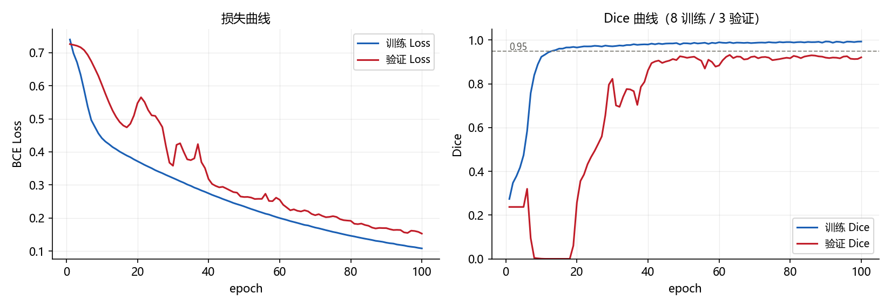
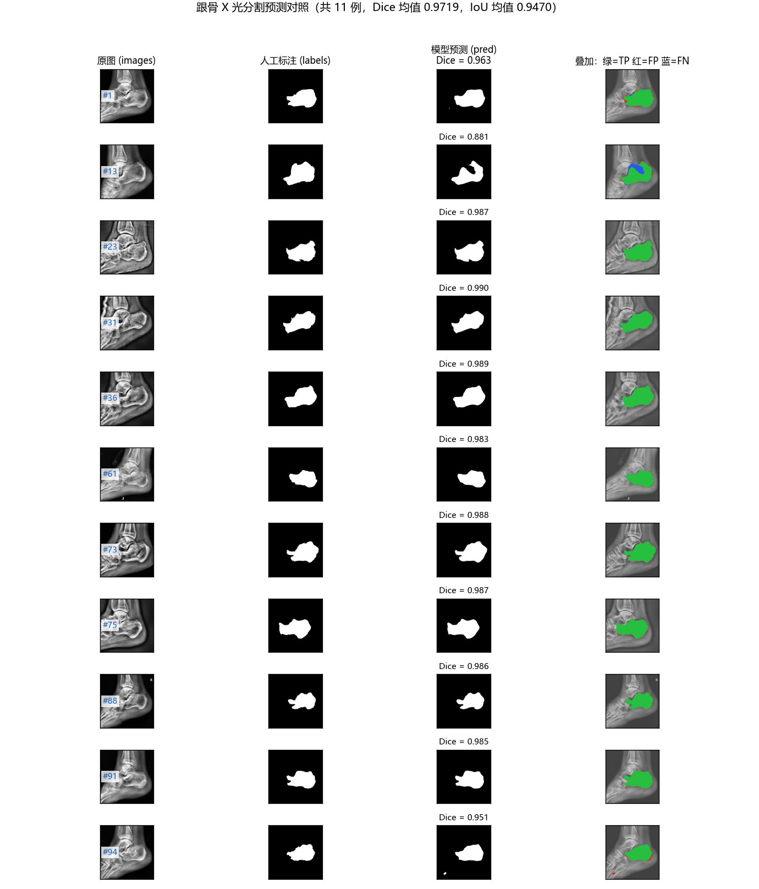

# 跟骨 X 光分割与临床角度自动测量

用 PyTorch 实现 U-Net 分割跟骨轮廓，再从轮廓上自动定位解剖关键点、计算 Böhler 角与 Gissane 角，并量化"分割误差会怎样传导成角度误差"。

> 本仓库基于课题组提供的跟骨侧位 X 光标注数据，重点是**方法复现与误差分析**：角度口径通过逐像素反推已有结果图得到，不依赖原始标注脚本。

---

## 1. 这个项目做什么

跟骨（脚后跟）关节内骨折的评估依赖两个放射学角度，传统做法是医生在 X 光片上手动画测量线，耗时且不同测量者之间不一致。

本项目实现一条**全自动**的测量链路：

```text
X 光片  →  跟骨分割（U-Net）  →  二值掩膜  →  取上边界轮廓
                                                      ↓
              Böhler 角 / Gissane 角  ←  余弦定理  ←  定位 4 个解剖关键点
```

并在其之上补了一环**误差传导分析**：量化"分割边界偏 1~3 像素，会让角度偏多少度"。

## 2. 临床背景

| 角度 | 含义 | 正常范围 | 骨折塌陷时的变化 |
|---|---|---|---|
| **Böhler 角** | 跟骨后关节面与跟骨结节上缘之间的关系 | 25° ~ 40° | 变小 |
| **Gissane 角** | 跟骨沟处的角度 | 120° ~ 145° | 变大 |

本项目使用的 11 例样本实测：Böhler 3.65°~18.99°、Gissane 145.46°~178.48°，偏离方向与"关节内跟骨骨折塌陷"一致。

## 3. 技术路线

**第一个环节：分割（需要训练）**

- 模型：4 层 U-Net（编码器 4 层下采样 + 瓶颈 + 解码器 4 层上采样），每层为「两个 3×3 卷积 + BatchNorm + ReLU」
- 关键设计：skip connection 把编码器每层的高分辨率特征直接拼接到解码器对应层，保住边界精度
- 参数量：`base=8` → 486,409　`base=16` → 1,942,289　`base=32` → 7,762,465
- 损失：`BCEWithLogitsLoss`（sigmoid 与交叉熵的合并实现，数值稳定）
- 输出：单通道 logits，预测时再 `sigmoid > 0.5` 二值化

**第二个环节：几何测量（纯数学，不需要训练）**

1. 取掩膜上边界 `y_top(x)`：每个 x 列最靠上的前景像素
2. 在边界上定位四个关键点：

   | 点 | 解剖位置 | 颜色 |
   |---|---|---|
   | A | 跟骨前突上缘最高点 | 绿 |
   | B | 后关节面最高点 | 绿 |
   | C | 跟骨结节上缘最高点 | 绿 |
   | D | 跟骨沟（载距突附近）顶点 | 红 |

3. 用余弦定理算两个角：

```text
cos θ = (u · v) / (|u| · |v|)      u、v 为从顶点出发的两个向量
θ = arccos(cos θ) × 180 / π
```

**⚠️ 角度口径说明（重要）**

本仓库采用的顶点取法与骨科教科书不同，这是**为对齐已有结果而做的选择**：

| 角度 | 本仓库口径 | 教科书口径 |
|---|---|---|
| Böhler | 顶点 = A（前突点） | 顶点 = B（后关节面点） |
| Gissane | 顶点 = D，两臂到 A 与 C | 顶点 = D，两臂到 A 与 B |

若按教科书定义计算，Böhler 角会得到 118°~168°，与已有结果图上印出的 3.65°~19° 完全不符。
**复现他人的结果时，第一步应对齐口径而不是对齐代码。**

## 4. 数据集

| 数据 | 数量 | 内容 | 是否可用于训练 |
|---|---|---|---|
| 已标注样本 | **11 例** | 256×256，含原图 / 人工掩膜 / 预测掩膜 / 参数可视化 | ✅ 唯一可训练的标注数据 |
| 原始临床片 | 74 张 | 仅原图，无任何标注 | ❌ 只能做预处理验证与无监督推理 |

已标注样本编号：`1, 13, 23, 31, 36, 61, 73, 75, 88, 91, 94`

**标注核查结果**

- 图像与掩膜尺寸全部 256×256，一一配对
- 掩膜取值仅 {0, 255}，标准二值掩膜
- 前景占比 10.65% ~ 16.00%（均值 13.32%）

**数据授权说明**

> 本仓库的**代码、方法与由数据派生的统计结果**，经课题组确认**可以公开**（确认时间 2026-10）。
>
> 但**原始影像不随仓库提供**：这批数据含患者信息，分发范围限于课题组内部。仓库里只有代码、以及不含可识别患者信息的派生结果（掩膜轮廓统计、训练曲线、对照图）。
>
> 需要复现的人请找课题组获取数据；数据就位后按下方第 6 节运行即可（`CALCANEUS_ROOT` 环境变量可指定路径）。
>
> 特别说明：`calcaneus_preprocess.py` 会把原始片重命名为 `case_001…`，并把「原名 → 编号」的映射写入单独标注为 `_PRIVATE_` 的文件 —— **该文件绝不可上传公开平台**，仓库的 `.gitignore` 已将其排除。

## 5. 目录结构

```text
Pytorch_calcaneus/
├── calcaneus_dataset.py        数据加载：配对、灰度化、缩放、归一化、二值化
├── unet.py                     U-Net 模型定义（DoubleConv + UNet）
├── train_calcaneus.py          训练与验证循环（Dice / IoU / 曲线 / 权重保存）
├── predict_calcaneus.py        加载权重预测 + 四列对照图可视化
├── calcaneus_angles.py         角度公式 + 轮廓距离 + 敏感度 + 误差传导
├── analyze_failure_case.py     失败案例解剖（逐例指标 / 三色叠加 / 边界偏差 / 归因判定）
├── leave_one_out.py            11 折留一交叉验证（含训练崩溃诊断与损失函数对比）
├── error_attribution.py        误差归因：把角度误差拆成「提点规则的」和「分割边界的」
├── demo_single_case.py         端到端单例演示（出 4 格图，单条命令可跑）
├── calcaneus_preprocess.py     74 张原始片脱敏与预处理
├── run_all.py                  ★ 一键复现入口：按顺序跑完全部步骤
├── requirements.txt            依赖与版本锁定
├── docs/
│   └── case13_failure_analysis.md   第 13 例失败案例的完整解剖（配图 + 数据化归因）
├── .gitignore
├── README.md
└── results/                    全部运行产物
    ├── *.pth                   训练权重（已被 .gitignore 忽略）
    ├── calcaneus_train_log_*.csv      逐轮训练指标
    ├── calcaneus_train_curve_*.png    训练曲线
    ├── calcaneus_predict_grid_*.png   预测对照图
    ├── calcaneus_predict_dice_*.csv   逐例 Dice / IoU
    ├── calcaneus_angles_*.{csv,png}   角度复现与误差传导结果
    ├── calcaneus_case_analysis.csv    逐例失败指标（11 例全量）
    ├── calcaneus_case13_analysis.png  第 13 例 6 格解剖图
    ├── calcaneus_loo_results*.csv     留一验证逐折指标（BCE / dice_bce）
    ├── calcaneus_loo*.png             留一验证柱状图与分布图
    └── calcaneus_demo_case*.png       端到端演示图
```

## 6. 环境与运行

**环境**

- Python 3.10 + PyTorch 2.11.0（cu128）+ CUDA
- 其他：numpy、Pillow、matplotlib（**MONAI 未被任何脚本直接 import**，属可选项）
- 注：本项目**不依赖 scipy 与 OpenCV**，距离变换与形态学操作用 numpy 自行实现
- 锁定版本见 `requirements.txt`；参考测试环境为单卡 8 GB 显存的消费级 GPU；没有 GPU 也能跑，只是慢一些

**一条命令跑完整条链路（推荐）**

```bash
pip install -r requirements.txt
python run_all.py                 # 8 步全跑，约 80 秒
python run_all.py --tag check     # 产物名加后缀，不覆盖仓库里已记录的产物
python run_all.py --skip-preprocess
```

`run_all.py` 会固定随机种子与 `PYTHONHASHSEED`，按正确顺序调用下面 7 个脚本，最后打印一张逐步耗时/成败的汇总表。
**它跑出来的数字与仓库 `results/` 里记录的数字不逐位相同，原因见第 7.5 节** —— 那不是 bug，是本项目的核心结论之一。

**逐脚本运行**

```bash
# 1) 只检查数据配对与张量形状
python calcaneus_dataset.py

# 2) 查看网络结构与三种规模的参数量
python unet.py

# 3) 过拟合测试：验证技术链路是否连通（约 10 秒）
python train_calcaneus.py --overfit --epochs 80 --tag overfit

# 4) 8 训练 / 3 验证：观察泛化趋势（约 11 秒）
python train_calcaneus.py --epochs 100 --tag split83

# 5) 预测并生成对照图
python predict_calcaneus.py --weights results/calcaneus_unet_best_split83.pth --tag _split83

# 6) 角度复现 + 敏感度 + 误差传导 + 关键点自动提取
python calcaneus_angles.py --mask results

# 7) 失败案例解剖（不指定 --id 时自动挑 Dice 最低的一例）
python analyze_failure_case.py

# 8) 11 折留一交叉验证（约 2 分钟）
python leave_one_out.py
python leave_one_out.py --loss dice_bce      # 换成 BCE+Dice 混合损失

# 9) 端到端演示（单例，含与参考值的数值对照）
python demo_single_case.py

# 10) 误差归因（角度误差拆成提点规则 + 分割边界）
python error_attribution.py

# 11) 74 张原始片脱敏预处理
python calcaneus_preprocess.py
```

> `run_all.py` 覆盖第 1–7 步与原始片预处理；**留一验证、误差归因与端到端演示需要单独跑** —— 它们不属于「训练一次就出结果」的链路。

数据根目录通过候选路径自动探测，也可用环境变量覆盖：

```bash
set CALCANEUS_ROOT=D:\你的路径\result\result      # Windows
set CALCANEUS_RAW=D:\你的路径\跟骨1                # 原始片目录
```

## 7. 实验结果与口径

### 7.1 分割

| 实验 | 训练 Dice | 验证 Dice | 验证 IoU | 耗时 |
|---|---|---|---|---|
| 过拟合测试（11 例全训练） | 0.9920 | — | — | 10.1 s |
| 8 训练 / 3 验证（seed=42） | 0.9933 | **0.9318** | 0.8574 | 10.7 s |



> 训练过程中第 10~15 轮验证 Dice 一度塌到 0（模型退化为"全预测背景"），第 30 轮后恢复。这是分割训练中的典型 collapse 现象，已如实保留在实验记录中。

用留出权重预测全部 11 例，可清楚区分"记住的"与"没见过的"：

| 类型 | 样本 | Dice |
|---|---|---|
| 验证集（未见） | 1 / **13** / 94 | 0.9631 / **0.8814** / 0.9510 |
| 训练集（见过） | 23, 31, 36, 61, 73, 75, 88, 91 | 0.983 ~ 0.990 |



图中第 4 列：**绿 = 预测正确，红 = 多预测，蓝 = 漏预测**。第 13 例是明确的失败案例。

### 7.2 角度复现

| 角度 | 复现误差（11 例平均绝对误差） |
|---|---|
| Böhler | **0.34°**（最大 1.01°） |
| Gissane | 6.31°（最大 12.36°） |

### 7.3 误差传导（本项目的核心结论）

先测分割边界误差，再测角度对每个关键点的敏感度，两者相乘：

> ⚠️ **先看清这一节用的是哪份掩膜。** `calcaneus_angles.py` 里的「预测掩膜」指
> **数据包自带的那份预测结果**（`result/result/results/`，也就是参数图所依据的那份），
> **不是**本项目自训 U-Net 的输出。两者的质量对比见第 7.6 节。
> 换句话说，下表中的 1.56 px 是**数据包自带那份掩膜**的边界误差。

| 指标 | 结果 |
|---|---|
| 分割边界平均偏差（mean SSD） | 0.91 ~ 3.05 px，均值 **1.56 px** |
| HD95 | 2.83 ~ 16.12 px |
| Böhler 角最敏感的点 | **B（0.74°/px）** |
| Gissane 角最敏感的点 | **D（2.28°/px）** |
| 传导出的角度误差（局部折算） | Böhler ±2.79°，Gissane ±2.10° |
| 传导出的角度误差（保守估计） | Böhler ±1.45°，Gissane ±4.45° |

**结论：分割边界平均只偏 1.56 像素，就足以让角度抖动 ±2~4 度。** 这意味着在当前分割精度下，把角度测到小数点后两位是没有意义的精度；若要压低角度误差，应优先提升跟骨沟附近的分割质量，而不是把角度算法写得更精细。

### 7.4 关键点自动提取的可行边界

| 关键点 | 从预测掩膜提取误差 | 能否自动提取 |
|---|---|---|
| A 前突上缘最高点 | 6.9 px | 勉强 |
| B 后关节面最高点 | **23.9 px** | ❌ 规则还原不出来 |
| C 跟骨结节上缘最高点 | 10.2 px | 勉强 |
| D 跟骨沟顶点 | **3.9 px** | ✅ 可靠 |

> ⚠️ **这是本仓库最重要的已知缺口。** D 点可由上边界的斜率拐点稳定定位，但 B 点无论用"曲率最大处""陡升终点""后关节面段最高点"等规则都无法还原，说明其定义不完全由轮廓几何决定。
>
> 另一个值得注意的现象：从**预测掩膜**提点普遍比从**人工掩膜**更接近参考位置（IoU 上也是 0.920 vs 0.871），所以已有的参数可视化图是在**模型预测结果**上绘制的，而非人工标注。
>
> 本表的「预测掩膜」同样指**数据包自带的那份**（`--mask results`，即 `result/result/results/`），不是本项目自训模型的输出。

### 7.5 ★ 可复现性：同一个种子，指标能漂多少

这是本项目**最该被记住的一节**，也是"不提供泛化结论"这个口径的量化依据。

固定随机种子（`--seed 42`）只能固定数据划分与参数初始化，**固定不了 GPU 上的非确定性** ——
cuDNN 会自动挑选卷积算法，同一份数据两次运行可能走到不同的算法实现上，误差逐轮累积。

实测（同一台机器、同一份数据、同一份代码、同一 `seed=42`）：

| 运行配置 | 8-3 训练的最好验证 Dice | 第 13 例 Dice | 11 例 Dice 均值 |
|---|---|---|---|
| 未开确定性卷积，运行 A | 0.9318 | 0.8814 | 0.9719 |
| 未开确定性卷积，运行 B | 0.9427 | — | — |
| 未开确定性卷积，运行 C | 0.9455 | — | — |
| **开启 `cudnn.deterministic`，运行 D** | **0.9461** | **0.9216** | **0.9785** |
| **开启 `cudnn.deterministic`，运行 E** | **0.9461** | — | — |

- 关掉确定性时：两次运行的逐轮指标**从第 1 轮起就不同**，最好验证 Dice 相差 0.3 个点。
- 开启确定性后：两次运行**逐轮 bit 级完全一致**（0.9461320241292318），可复现。
- 因此 `train_calcaneus.py` 的 `set_seed()` 现在**默认开启** `cudnn.deterministic`。

**问题来了**：仓库 `results/` 里记录的是运行 A（早于本次改动，未开确定性），而 `run_all.py` 重跑得到的是运行 D ——
所以**重跑的数字与仓库里记录的不逐位相同**。这不是 bug：

- 数值敏感的产物：训练日志、训练曲线、逐例 Dice、第 13 例解剖 → 会差
- 数值**不**敏感的产物：`calcaneus_angles_*.csv/png` → **完全一致**（它只依赖掩膜与参考关键点，不依赖模型）

**这个 1.4 个点的漂移，比任何模型改动能带来的提升都大。** 在 11 例 / 3 例验证集这个规模上，
谈论"模型 Dice 是 0.93 还是 0.94"没有意义 —— 这正是第 9 节第 1 条局限的实证。

### 7.6 自训模型 vs 数据包自带掩膜

同一次运行下，把两份掩膜都拿去和人工 GT 比：

| | 合并 IoU | 合并 Dice | 第 13 例 IoU |
|---|---|---|---|
| 数据包自带掩膜（`result/result/results/`） | 0.9275 | 0.9624 | **0.9274** |
| 本项目自训 U-Net | **0.9445** | **0.9715** | 0.7880 |

两条都要说：**整体上自训模型更好**（IoU +0.017），但**在第 13 例上明显更差**。
原因分析见 `docs/case13_failure_analysis.md`（这一例的前景占比 16%，是全库最高，训练集里最大只有 14.93%）。

> 结合第 7.5 节：+0.017 的 IoU 优势与运行噪声同量级，因此**不宜表述为"我的模型比它强"**，
> 只宜表述为"两者水平相当，且各有更差/更好的案例"。

### 7.7 失败案例

`#13` 是全库唯一明显失败的一例（本次运行记录：Dice 0.8814，其余 10 例均值 0.9809）。
完整解剖（三色叠加、上边界曲线、逐列偏差、三条假设的数据化判定）见
**[`docs/case13_failure_analysis.md`](docs/case13_failure_analysis.md)**，
图见 `results/calcaneus_case13_analysis.png`，可用 `python analyze_failure_case.py` 复现。

### 7.8 留一交叉验证与训练崩溃（2026-10 新增）

**为什么做**：原来的 8/3 划分只用了 3 例当测试，Dice 在 0.88~0.96 之间跳，说好说坏都没有依据。
留一验证让**每一例都当过一次测试样本**，于是能给一个分布，而不是三个数字。

```bash
python leave_one_out.py                       # 11 折，每折 10 例训练 / 1 例测试，约 2 分钟
python leave_one_out.py --loss dice_bce       # 换成 BCE+Dice 混合损失
python leave_one_out.py --only 31,73 --repeats 3   # 只跑指定折并换种子，用于诊断崩溃
```

**结果（11 折，seed=42）**

| 配置 | Dice 均值 ± 标准差 | 中位数 | 四分位区间 | 最小值 | Dice<0.95 折数 |
|---|---|---|---|---|---|
| `BCE`（原配置） | 0.8327 ± **0.2414** | 0.9406 | 0.9012 – 0.9526 | **0.3333** | 6 / 11 |
| `BCE + Dice` | 0.9499 ± **0.0253** | 0.9536 | 0.9449 – 0.9664 | 0.8827 | 5 / 11 |

**发现了什么：11 折里有 2 折完全崩溃。**

- #31 → Dice 0.3598，#73 → Dice 0.3333；两折的**预测前景占比冲到 63.8% / 68.2%**（GT 只有 14%），
  即模型退化成「全前景」，面积比 4.5 / 4.7。
- 这与 7.1 节 8/3 训练里观察到的「第 10–15 轮验证 Dice 塌到 0」（退化成**全背景**）是同一类现象的两个方向。

**崩溃是「种子依赖」，不是「样本依赖」** —— 换种子重跑这两折：

| 测试例 | seed=42 | seed=1042 | seed=2042 |
|---|---|---|---|
| #31 | **0.3598** | 0.8343 | 0.9635 |
| #73 | **0.3333** | 0.9505 | 0.9418 |

同一例换个种子能从 0.33 变成 0.96，同折不同种子的 Dice 极差最大 **0.6172**。
⇒ 崩溃是**训练不稳定的一次随机落点**，不是"这两例特别难"。

**干预：混合损失把崩溃压住（同种子、同划分，唯一变量是损失函数）**

| 配置（seed=42） | #31 | #73 | 面积比 |
|---|---|---|---|
| `BCE` | 0.3598 | 0.3333 | 4.54 / 4.75 |
| `BCE + Dice`（0.5×BCE + 0.5×soft-Dice） | **0.8827** | **0.9536** | 1.15 / 1.07 |

跑满 11 折后，标准差从 **0.2414 降到 0.0253**（缩小约 10 倍），最小值从 0.3333 抬到 0.8827。

> ⚠️ 正确表述：这是「**混合损失降低了训练崩溃的概率，使结果不再对种子敏感**」，
> **不是**「混合损失更准」—— 对照实验里 BCE 换种子也能跑到 0.94~0.96。

**它顺带推翻了 8/3 划分的那次结论**：验证集是 1、13、94，而这三例在留一里恰好是
0.9677 / 0.9129 / 0.9611 —— **那次划分运气好，恰好没抽到崩溃折**。
想验证「哪 3 例当验证集」的影响，直接看留一分布即可。

> ⚠️ **口径**：留一给的是 11 例上的结果分布，**仍然不是泛化性能**。它比 8/3 划分强的地方在于
> 不再有「哪 3 例当验证集」这个运气因素，但样本量小这个根本问题没有被解决，只是被量化了。
> 另外留一每折用 10 例训练（8/3 划分只用 8 例），训练集更大，两者**不能直接比大小**。

产物：`results/calcaneus_loo_results.csv`（BCE）、`results/calcaneus_loo_results_dicebce.csv`（混合损失）、
`results/calcaneus_loo.png`、`results/calcaneus_loo_dicebce.png`。

### 7.9 端到端演示

```bash
python demo_single_case.py            # 自动挑分割最好的一例
python demo_single_case.py --id 91
```

一张侧位片进模型 → 掩膜 → 上边界轮廓 → 4 个关键点 → Böhler / Gissane 角，出 4 格演示图
（`results/calcaneus_demo_case{id}.png`）并在终端打印与参数图印出值的对照。

> 图上写明了：**关键点用的是逐像素反推的参考位置，不是自动提取的**（原因见 7.4 节）。
> 这条链路应表述为「差一环的全自动」，不要说成「全自动」。

### 7.10 误差归因：角度误差到底来自哪里（2026-10 新增）

7.3 节的结论「1.56 px → ±2~4°」里混着两个误差源：**提点规则的误差**和**掩膜边界的误差**。
不拆开就没法回答「下一步该优化哪里」。本节把它们拆开。

```bash
python error_attribution.py                   # 预测掩膜 = 本仓库自训 U-Net
python error_attribution.py --pred-source pkg # 预测掩膜 = 数据包自带掩膜
```

**实验设计：3 条支线 / 2 个减法**

| 支线 | 组合 | 含义 |
|---|---|---|
| ① | 人工掩膜 + 参考提点 → **A1** | 基线（关键点用逐像素反推的参考位置） |
| ② | 人工掩膜 + 自动提点 → **A2** | **A2 − A1 = 提点规则误差**（掩膜没变，只换提点方式） |
| ③ | 预测掩膜 + 自动提点 → **A3** | **A3 − A2 = 分割边界误差**（提点规则没变，只换掩膜） |

> **为什么不是 4 条支线**：原计划里第 4 条「预测掩膜 + 参考提点」是**退化的** ——
> 角度只由关键点坐标决定，关键点一旦固定在参考位置，掩膜就完全不影响结果，那一格必然恒等于 A1。
> 所以正确的因子设计只能到 3 格。写成 4 格会在答辩时被问倒。

**结果（11 例平均绝对误差，单位：度）**

| 角度 | 基线复现 | 提点规则 (A2−A1) | 分割边界 (A3−A2) | 端到端 (A3 vs 印出值) |
|---|---|---|---|---|
| **Böhler** | 0.34 | **6.19**（中位 4.27） | 4.90（中位 1.41） | 7.50 |
| **Gissane** | 6.31 | **13.37**（中位 8.07） | 6.17（中位 2.43） | 11.08 |

**结论：两个角的最大误差源都是「提点规则」，不是分割边界。**

- Böhler：提点 6.19° vs 分割 4.90°（均值 1.3 倍；**用中位数看是 3.0 倍**）
- Gissane：提点 13.37° vs 分割 6.17°（均值 2.2 倍；**用中位数看是 3.3 倍**）

⇒ **继续提升分割精度对角度结果没有意义**，唯一的解法是获得关键点的定义规则与标注脚本
（B 点几何规则已穷尽且失败，见 7.4）。这一条把「要不要继续优化分割」这个方向问题回答掉了。

**与 7.3 的交叉印证**：7.3 用「敏感度 × 边界偏移」独立折算得到 ±1.45~2.79°（Böhler）/ ±2.10~4.45°（Gissane）；
本次直接重提点测到的「分割边界」贡献中位数是 **1.41° / 2.43°** —— **两种独立方法同量级**，
互相印证。均值（4.90° / 6.17°）被个别大误差样本（#13、#94、#75）抬高。

> **三条必须一起说的口径**
> 1. A1 基线自身带误差（Böhler 0.34° / Gissane 6.31°），分解是在「以反推参考点为真值」的前提下成立的。
>    **Gissane 的基线误差（6.31°）与它的分割贡献（6.17°）同量级，所以 Gissane 的归因结论比 Böhler 弱。**
> 2. 端到端 7.50° / 11.08° 是「全自动链路 vs 参数图印出值」，它同时包含上面三项，
>    其中「基线复现」那一项里混着反推参考点本身的误差，不能全部算作该方法链路的误差。
> 3. 这是 11 例的结果，不是统计结论。

产物：`results/calcaneus_error_attribution.csv`、`results/calcaneus_error_attribution.png`。

---

## 8. 代码模块说明

| 文件 | 职责 | 关键实现 |
|---|---|---|
| `calcaneus_dataset.py` | 数据加载 | `CalcaneusDataset`（按文件名编号配对）、`dice_score`、`iou_score` |
| `unet.py` | 模型定义 | `DoubleConv`、`UNet`（4 层，输出 logits） |
| `train_calcaneus.py` | 训练验证 | `set_seed`（含 cuDNN 确定性）、逐轮记录、按最优验证 Dice 保存权重 |
| `predict_calcaneus.py` | 预测可视化 | 阈值化、TP/FP/FN 三色叠加图 |
| `calcaneus_angles.py` | 角度与误差 | 余弦定理、自实现精确欧氏距离变换、中心差分求敏感度、关键点自动提取 |
| `analyze_failure_case.py` | 失败案例解剖 | 逐例指标表、6 格解剖图、三条归因假设的数据化判定 |
| `leave_one_out.py` | 留一交叉验证 | 11 折轮流、`--only`/`--repeats`/`--loss` 诊断选项、`SoftDiceLoss` |
| `error_attribution.py` | 误差归因 | 3 支线因子设计（人工/预测掩膜 × 参考/自动提点）、两项分解与端到端对照 |
| `demo_single_case.py` | 端到端演示 | 单例分割 → 轮廓 → 关键点 → 角度，4 格演示图 + 数值卡 |
| `run_all.py` | 一键复现 | 按序调用全部步骤、固定种子与 hash seed、汇总耗时与成败 |
| `calcaneus_preprocess.py` | 原始片预处理 | 脱敏重命名、尺寸与灰度统计 |

## 9. 已知局限与后续计划

**局限**

1. **样本量**：全库只有 11 例带标注，验证集仅 3 例（Dice 在 0.88~0.96 之间波动），**因此本仓库不提供任何泛化性能结论**。过拟合测试的 0.9920 只用于验证技术链路连通，不代表模型效果。
2. **关键点定义来自反推**：角度公式已复现（Böhler 误差 0.34°），但 B 点的定位规则未能还原。
3. **归一化方式**：目前使用逐图 min-max，会掩盖不同片子的曝光差异；更稳妥的做法是固定窗宽窗位或分位数截断。
4. **未做部署**：模型尚未导出 ONNX，也没有做推理延迟 / 显存测量。

**后续计划**

- [x] 建立可复现入口（`requirements.txt` + `run_all.py` + 固定种子）—— 2026-10
- [x] 失败案例分析（`analyze_failure_case.py` + `docs/case13_failure_analysis.md`）—— 2026-10
- [x] 可复现性实测：量化 GPU 非确定性对指标的影响（见 7.5 节）—— 2026-10
- [x] 11 折留一交叉验证 + 训练崩溃定位与干预（见 7.8 节）—— 2026-10
- [x] 端到端单例演示（见 7.9 节）—— 2026-10
- [x] 误差归因实验：拆出「提点规则 vs 分割边界」（见 7.10 节）—— 2026-10
- [ ] 把 `BCE + Dice` 设为 `train_calcaneus.py` 的默认损失（需重跑并更新 `results/` 全部依赖模型的产物）
- [ ] 更多随机种子的留一（`--repeats 3`），把「崩溃概率」从 1/3 量到更稳的数字
- [ ] 取得 B 点的定义规则（**需向数据提供方获取标注脚本**，几何规则已穷尽且失败）
- [ ] 加入数据增强与类别不平衡处理（注意：11 例上很可能观察不到显著差异，需如实报告）
- [ ] 引入 MONAI 规范流程与更强基线做对比
- [ ] 导出 ONNX 验证推理一致性，再做量化与延迟 / 显存测量

## 10. 数据与隐私

- 本仓库**不包含任何患者影像或患者姓名**，仅包含代码、由数据派生的统计与可视化结果、以及三个脚本自身。
- **代码与方法的公开已获课题组确认**（2026-10）；原始影像因含患者信息，不随仓库分发。
- 数据就位后可用 `CALCANEUS_ROOT` 指定路径运行全部流程；找不到数据时 `run_all.py` 会给出明确提示，不会静默失败。
- `calcaneus_preprocess.py` 会生成 `case_001…` 脱敏副本，并把「原名 → 编号」映射写入 `_PRIVATE_原名映射_切勿公开.csv`。
  该文件已在 `.gitignore` 中排除，**任何情况下都不得上传**。
- 请注意：本节说明的是「代码与派生结果可公开」，**不等于患者影像可以公开**。


## 11. 参考

- U-Net: Ronneberger O, Fischer P, Brox T. *U-Net: Convolutional Networks for Biomedical Image Segmentation*. MICCAI 2015.

