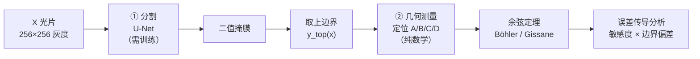
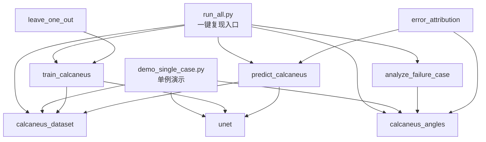

# 架构说明

跟骨 X 光分割与临床角度自动测量（PyTorch U-Net + 几何测量）。

## 1. 一句话定位

用 U-Net 分割跟骨轮廓，再从轮廓上定位解剖关键点、算 Böhler 角与 Gissane 角，
并量化"分割误差会怎样传导成角度误差"。

**工程重点不是"训一个分割模型"，而是把"这个角度到底准不准、误差来自哪里"回答清楚。**

## 2. 两段式链路

两段的性质完全不同：

| 环节 | 是否需要训练 | 可复现性 | 主要误差源 |
|---|---|---|---|
| ① 分割 | 是 | 受 GPU 非确定性影响 | 网络 + 数据 |
| ② 几何测量 | 否 | **完全确定性** | 提点规则 |

这条界线带来一个重要结论：**几何部分的结果每次跑都逐位一致**，
而分割部分同种子也会有 0.3 个点的漂移（见 debug_log）。

## 3. 模块分层

| 层 | 文件 | 职责 |
|---|---|---|
| **数据层** | `calcaneus_dataset.py` | 按文件名编号配对 image/label、灰度化、缩放、归一化、二值化 |
| **模型层** | `unet.py` | `DoubleConv` + 4 层 `UNet`，输出 logits |
| **训练层** | `train_calcaneus.py` | `set_seed`（含 cuDNN 确定性）、训练/验证循环、按最优验证 Dice 存权重 |
| **预测层** | `predict_calcaneus.py` | 加载权重、阈值化、TP/FP/FN 三色叠加图 |
| **几何层** | `calcaneus_angles.py` | 余弦定理、距离变换、敏感度、关键点提取、误差传导 |
| **分析层** | `analyze_failure_case.py` `leave_one_out.py` `error_attribution.py` | 失败案例解剖、11 折留一、误差归因 |
| **入口层** | `run_all.py` `demo_single_case.py` | 一键复现 / 单例端到端演示 |
| **工具层** | `calcaneus_preprocess.py` | 原始片脱敏重命名与预处理 |

## 4. 模块依赖

`calcaneus_angles.py` 是**被依赖最多的模块**——三个分析脚本都建立在它之上，
因为它同时提供"角度公式"和"轮廓几何"这两组原子能力。

## 5. 关键设计决策

| 决策 | 理由 |
|---|---|
| **U-Net 输出 logits，不在模型里 sigmoid** | 配合 `BCEWithLogitsLoss`（数值更稳），预测时再手动 `sigmoid > 0.5` |
| **skip connection 逐层 `torch.cat`** | 保住边界精度——分割边界直接决定角度精度 |
| **距离变换自己用 numpy 实现** | 不引入 scipy/OpenCV 依赖，保持 `requirements.txt` 轻量（Felzenszwalb 一维抛物线下包络） |
| **敏感度用中心差分（h=0.5 px）** | 角度公式是解析式但含 `arccos`，数值微分比手推偏导更不容易错 |
| **自动提点与参考提点分开** | 才能把"提点规则误差"和"分割边界误差"拆开做归因 |
| **`set_seed` 默认开 `cudnn.deterministic`** | 不开的话同种子逐轮指标从第 1 轮就不同（实测差 0.3 点） |
| **分析脚本与主链路分离** | 留一验证 / 误差归因不属于"训练一次就出结果"，单独跑 |

## 6. 数据与隐私边界

| 项 | 说明 |
|---|---|
| 仓库内容 | **只有代码 + 派生统计与可视化**，不含任何患者影像 |
| 可训练数据 | 11 例带标注（256×256） |
| 不可训练数据 | 74 张原始临床片（无标注，仅能验证预处理与无监督推理） |
| 数据分发 | 限于课题组内部；复现需向课题组获取 |
| 脱敏映射 | `calcaneus_preprocess.py` 生成的原名映射文件已 `.gitignore` 排除，**绝不可上传** |

这条边界是硬性的：**"代码与方法可公开" ≠ "患者影像可公开"**。
