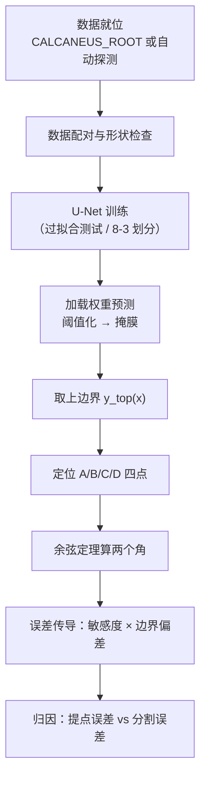
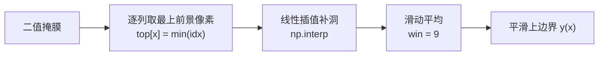
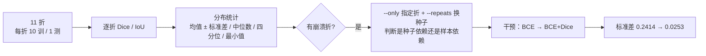

# 执行流程

从一张 X 光片到"角度值 + 误差来源"的完整链路。

## 1. 总流程



## 2. 一键复现（`run_all.py`，约 80 秒）

固定随机种子与 `PYTHONHASHSEED`，按正确顺序调用 7 个脚本，最后打印逐步耗时/成败汇总表。

| 步 | 内容 | 是否依赖模型 |
|---|---|---|
| 1 | 数据配对与张量形状检查 | 否 |
| 2 | 网络结构与三种规模参数量 | 否 |
| 3 | 过拟合测试（11 例全训练，验证链路连通） | 是 |
| 4 | 8 训练 / 3 验证 | 是 |
| 5 | 预测 + 四列对照图 | 是 |
| 6 | 角度复现 + 敏感度 + 误差传导 | 部分（用数据包自带掩膜） |
| 7 | 失败案例解剖 | 是 |
| 8 | 原始片脱敏预处理 | 否 |

> **留一验证、误差归因、端到端演示需要单独跑** —— 它们不属于"训练一次就出结果"的链路。

## 3. 分割环节的完整流程

```
X 光片（256×256 灰度）
  └─ CalcaneusDataset：配对 → 灰度化 → 缩放 → 归一化 → 二值化标签
       └─ UNet(1, 1, base=16)：4 层下采样 → 瓶颈 → 4 层上采样（逐层 cat skip）
            └─ 输出单通道 logits
                 └─ BCEWithLogitsLoss 训练，按最优验证 Dice 存 best.pth
                      └─ 预测：sigmoid(logits) > 0.5 → 二值掩膜
```

**关键判据**：`--overfit` 模式下训练 Dice 应逼近 1.0（实测 0.9920）。
达不到就说明链路某处断了（数据配对、损失、梯度），**不要急着调超参**。

## 4. 几何测量环节

### 4.1 上边界提取



### 4.2 四个关键点

| 点 | 解剖位置 | 提取规则 | 可提取性 |
|---|---|---|---|
| **A** | 跟骨前突上缘最高点 | 上边界最前端；若前 8 列骤降 > 15 px（尖突）则取骤降之后 | 6.9 px 误差，勉强 |
| **B** | 后关节面最高点 | D 与 C 之间曲率最大处 | **23.9 px，失败** |
| **C** | 跟骨结节上缘最高点 | 上边界全局最高（`argmin(ys)`） | 10.2 px，勉强 |
| **D** | 跟骨沟顶点 | 斜率最陡上升处，向左回退到 \|斜率\| < 峰值 35% 的列 | **3.9 px，可靠** |

### 4.3 角度计算

```
u = P - vertex      v = Q - vertex
cos θ = (u·v) / (|u|·|v|)
θ = arccos(cos θ) × 180 / π
```

**口径（与教科书不同，为对齐已有结果而选）**：

| 角度 | 本仓库顶点 | 教科书顶点 |
|---|---|---|
| Böhler | **A**（前突点） | B（后关节面点） |
| Gissane | D，两臂到 A 与 C | D，两臂到 A 与 B |

按教科书算 Böhler 会得到 118°~168°，与已有结果图印出的 3.65°~19° 完全不符。

## 5. 误差传导分析流程

### 5.1 「敏感度 × 边界偏移」折算（`calcaneus_angles.py`）

```
① 算分割边界偏差
   对称表面距离 = 预测轮廓每点到人工轮廓的距离 + 反向
   mean SSD ≈ 1.56 px，HD95 = 2.83 ~ 16.12 px

② 算每个关键点的敏感度
   中心差分：把某点的 x 或 y 挪 0.5 px，看角度变化几度
   Böhler 最敏感 = B（0.74°/px）；Gissane 最敏感 = D（2.28°/px）

③ 相乘得到局部折算误差
   Böhler ±2.79°；Gissane ±2.10°（保守估计 ±1.45° / ±4.45°）
```

### 5.2 三支线因子设计（`error_attribution.py`）

把"提点规则误差"和"分割边界误差"拆开，**一条减法一条**：

| 支线 | 组合 | 含义 |
|---|---|---|
| ① | 人工掩膜 + 参考提点 → **A1** | 基线（关键点用逐像素反推的参考位置） |
| ② | 人工掩膜 + 自动提点 → **A2** | **A2 − A1 = 提点规则误差** |
| ③ | 预测掩膜 + 自动提点 → **A3** | **A3 − A2 = 分割边界误差** |

**为什么不设第 4 条**（预测掩膜 + 参考提点）：它是**退化的** ——
角度只由关键点坐标决定，关键点一旦固定在参考位置，掩膜就完全不影响结果，
那一格必然恒等于 A1。所以正确的因子设计只能到 3 格。

### 5.3 归因结论

| 角度 | 提点规则误差 | 分割边界误差 | 差多少 |
|---|---|---|---|
| Böhler | **6.19°**（中位 4.27） | 4.90°（中位 1.41） | 中位数看是 3.0 倍 |
| Gissane | **13.37°**（中位 8.07） | 6.17°（中位 2.43） | 中位数看是 3.3 倍 |

⇒ **最大误差源是提点规则，不是分割边界。** 继续提升分割精度对角度结果没有意义。

## 6. 留一交叉验证流程



**判据**：崩溃折的表现是**预测前景占比冲到 60%+**（GT 只有 14%），
即模型退化成"全前景"。与 8/3 训练里"验证 Dice 塌到 0（全背景）"是同一类现象的两个方向。

## 7. 产物与它对应的口径

| 产物 | 依赖模型 | 重跑是否一致 |
|---|---|---|
| `calcaneus_train_log_*.csv` / 训练曲线 | 是 | **不一致**（GPU 非确定性） |
| `calcaneus_predict_dice_*.csv` / 对照图 | 是 | **不一致** |
| `calcaneus_case_analysis.csv` / 第 13 例解剖图 | 是 | **不一致** |
| **`calcaneus_angles_*.csv/png`** | **否** | **完全一致** |

最后一行很重要：角度与误差传导只依赖掩膜与参考关键点，不依赖模型，
所以它是这个仓库里**唯一能逐位复现**的分析产物。
